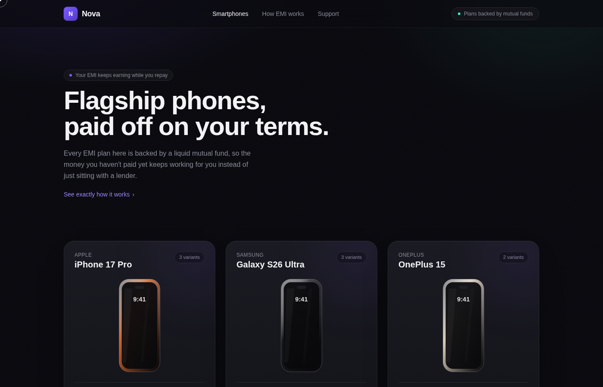
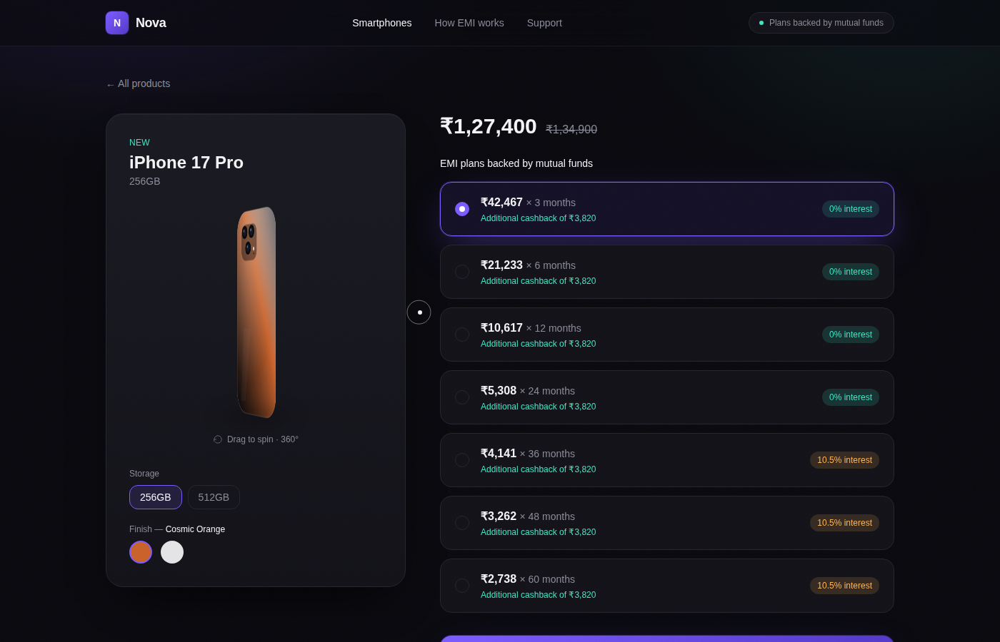
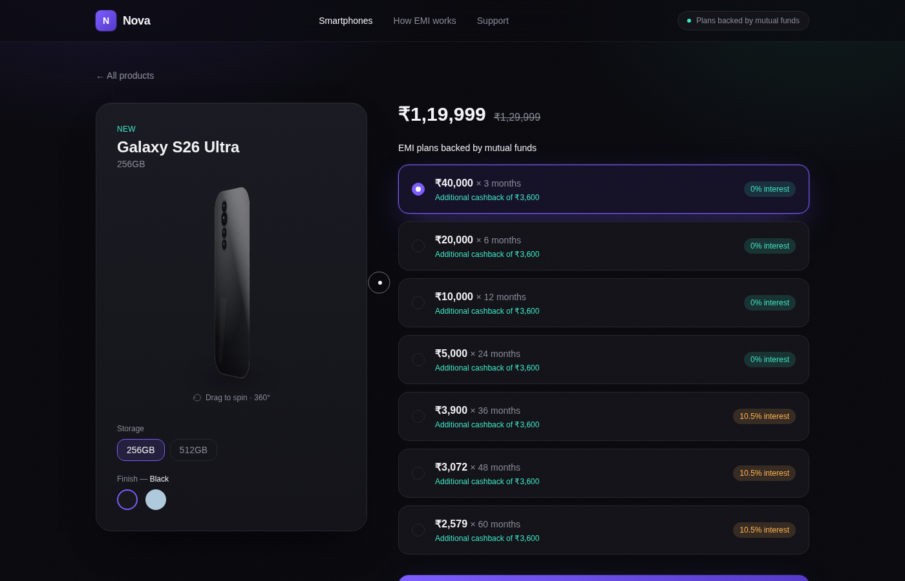
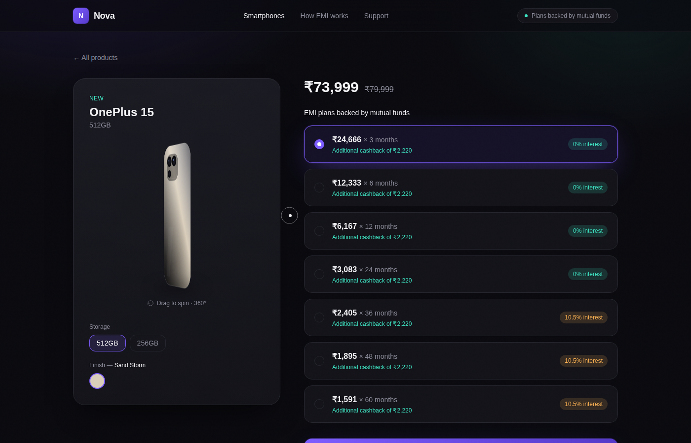
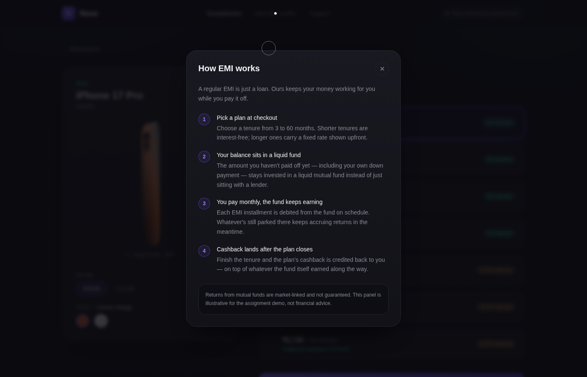
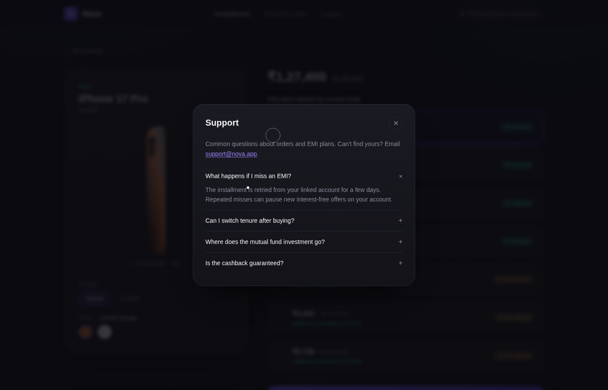

# Nova — Smartphones on EMI, backed by mutual funds

A full-stack product page that shows flagship smartphones with multiple EMI
plans, built for the 1Fi SDE1 assignment. Product, variant and EMI data is
served dynamically from a SQLite database through a REST API — nothing is
hardcoded in the frontend.








## Tech stack

| Layer     | Choice                                                   |
|-----------|-----------------------------------------------------------|
| Frontend  | React 18 (Vite), React Router, Tailwind CSS               |
| Backend   | Node.js + Express                                          |
| Database  | SQLite, via Node's built-in `node:sqlite` module (no native build step) |

`node:sqlite` ships with Node.js itself (stable from Node 22.5+, used here
behind the `--experimental-sqlite` flag), so the whole backend runs with
zero native/compiled dependencies — just `npm install` and go.

## Project structure

```
emi-app/
├── backend/
│   ├── src/
│   │   ├── db.js       # SQLite connection + schema
│   │   ├── seed.js      # seed script: 3 products × variants × EMI plans
│   │   └── server.js    # Express app + REST API
│   ├── db/store.sqlite  # generated on seed (gitignored, regenerate with `npm run seed`)
│   └── package.json
└── frontend/
    ├── src/
    │   ├── api/client.js         # fetch wrapper for the API
    │   ├── components/
    │   │   ├── phoneArt.jsx          # shared front/back SVG artwork, per-brand camera layouts
    │   │   ├── Phone3D.jsx           # drag-to-rotate 360° viewer (real CSS 3D, not swapped frames)
    │   │   ├── TiltCard.jsx          # pointer-reactive 3D tilt used on grid cards
    │   │   ├── Modal.jsx             # reusable accessible modal
    │   │   ├── HowEmiWorksModal.jsx  # wired to the navbar's "How EMI works" link
    │   │   ├── SupportModal.jsx      # wired to the navbar's "Support" link, FAQ accordion
    │   │   ├── EmiPlanCard.jsx, ProductCard.jsx, Navbar.jsx, CustomCursor.jsx
    │   ├── pages/                # Home.jsx, ProductPage.jsx
    │   └── App.jsx / main.jsx
    └── package.json
```

## Setup & run instructions

Requires **Node.js 22.5+** (for `node:sqlite`).

### 1. Backend

```bash
cd backend
npm install
npm run seed     # creates & populates db/store.sqlite
npm start        # http://localhost:4000
```

### 2. Frontend

In a second terminal:

```bash
cd frontend
npm install
npm run dev       # http://localhost:5173
```

The Vite dev server proxies `/api/*` requests to `http://localhost:4000`
(see `frontend/vite.config.js`), so just open `http://localhost:5173`.

### Production build

```bash
cd frontend
npm run build      # outputs frontend/dist — deploy as a static site
```

Deploy `backend` as a Node web service (Render, Railway, Fly.io, a VM, etc.)
and `frontend/dist` as a static site (Vercel, Netlify, Render static site),
pointing the frontend at the deployed API URL (update `BASE` in
`frontend/src/api/client.js` or add an env-based rewrite).

## Database schema

```
products
├── id            INTEGER PK
├── slug          TEXT UNIQUE      -- used in /products/:slug URLs
├── name          TEXT
├── brand         TEXT
├── category      TEXT
├── description   TEXT
└── created_at    TEXT

variants                                   (a product's storage/color combos)
├── id            INTEGER PK
├── product_id    INTEGER FK -> products.id
├── variant_name  TEXT                     -- e.g. "256GB · Cosmic Orange"
├── storage       TEXT
├── color         TEXT
├── color_hex     TEXT
├── mrp           INTEGER
├── price         INTEGER
├── image_url     TEXT
└── in_stock      INTEGER (bool)

emi_plans                                  (per-variant EMI options)
├── id             INTEGER PK
├── variant_id     INTEGER FK -> variants.id
├── tenure_months  INTEGER
├── monthly_amount INTEGER
├── interest_rate  REAL             -- 0 for interest-free tenures
├── cashback       INTEGER
└── fund_backer    TEXT             -- e.g. "Liquid Mutual Fund"
```

Relationships: one product → many variants → many EMI plans. Seed data
covers 3 products (iPhone 17 Pro, Galaxy S26 Ultra, OnePlus 15), each with
2–3 variants, each variant with 7 EMI tenures (3 to 60 months).

## API endpoints & example responses

### `GET /api/products`
List all products with a preview variant for grid cards.

```json
{
  "count": 3,
  "products": [
    {
      "id": 1,
      "slug": "iphone-17-pro",
      "name": "iPhone 17 Pro",
      "brand": "Apple",
      "category": "Smartphones",
      "description": "Titanium design, A19 Pro chip, ...",
      "variantCount": 3,
      "preview": {
        "id": 1,
        "variantName": "256GB · Cosmic Orange",
        "storage": "256GB",
        "color": "Cosmic Orange",
        "colorHex": "#C9622B",
        "mrp": 134900,
        "price": 127400,
        "imageUrl": "/images/iphone-17-pro-orange.png",
        "inStock": true,
        "emiPlans": [
          { "id": 1, "tenureMonths": 3, "monthlyAmount": 42467, "interestRate": 0, "cashback": 3820, "fundBacker": "Liquid Mutual Fund", "isZeroInterest": true }
        ]
      }
    }
  ]
}
```

### `GET /api/products/:slug`
Full product detail with every variant and its EMI plans.

```json
{
  "id": 1,
  "slug": "iphone-17-pro",
  "name": "iPhone 17 Pro",
  "brand": "Apple",
  "category": "Smartphones",
  "description": "Titanium design, A19 Pro chip, ...",
  "variants": [
    {
      "id": 1,
      "variantName": "256GB · Cosmic Orange",
      "storage": "256GB",
      "color": "Cosmic Orange",
      "colorHex": "#C9622B",
      "mrp": 134900,
      "price": 127400,
      "imageUrl": "/images/iphone-17-pro-orange.png",
      "inStock": true,
      "emiPlans": [
        { "id": 1, "tenureMonths": 3,  "monthlyAmount": 42467, "interestRate": 0,    "cashback": 3820, "fundBacker": "Liquid Mutual Fund", "isZeroInterest": true },
        { "id": 2, "tenureMonths": 6,  "monthlyAmount": 21233, "interestRate": 0,    "cashback": 3820, "fundBacker": "Liquid Mutual Fund", "isZeroInterest": true },
        { "id": 5, "tenureMonths": 36, "monthlyAmount": 4141,  "interestRate": 10.5, "cashback": 3820, "fundBacker": "Liquid Mutual Fund", "isZeroInterest": false }
      ]
    }
  ]
}
```

404 shape when the slug doesn't exist:
```json
{ "error": "No product found for slug \"unknown-phone\"" }
```

### `POST /api/orders`
Demo "proceed with plan" endpoint. No real payment is processed.

Request:
```json
{ "variantId": 1, "emiPlanId": 5 }
```

Response `201`:
```json
{
  "orderId": "ORD-1735900000000",
  "status": "created",
  "variant": "256GB · Cosmic Orange",
  "tenureMonths": 36,
  "monthlyAmount": 4141,
  "message": "Order created. This is a demo endpoint - no real payment is processed."
}
```

### `GET /api/health`
```json
{ "status": "ok" }
```

## Design notes

- **Product visuals are generated SVG artwork**, tinted per variant color
  with a camera module modeled on each real device's actual layout —
  iPhone 17 Pro's diagonal triple-lens square, Galaxy S26 Ultra's
  standalone vertical lens row, OnePlus 15's rounded triple-lens module —
  rather than real product photography, since we don't hold rights to
  reproduce Apple/Samsung/OnePlus marketing images. The schema still
  models a real `image_url` field for when licensed photography is
  available; swap `PhoneFront`/`PhoneBack` in `phoneArt.jsx` for an
  `` at that point and `Phone3D` keeps working unchanged.
- **360° view**: `Phone3D.jsx` is a genuine CSS 3D object, not a sequence
  of pre-rendered photo frames. A flat front/back pair is rotated in 3D
  space with `backface-visibility: hidden`, so the browser's own
  perspective math foreshortens the card as you drag it — the same
  technique behind CSS flip-cards, extended into a continuous drag.
- The product page also has a pointer-reactive tilt on grid cards, a
  custom cursor, and a shimmer sweep on the primary CTA, all restrained
  and `prefers-reduced-motion`-aware.
- **"How EMI works" and "Support"** in the navbar open real modals (not
  placeholder links): a 4-step EMI explainer and an FAQ accordion with a
  support email.
